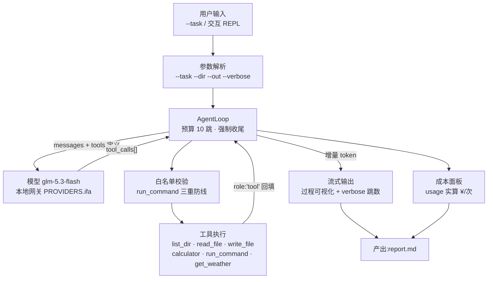

# P1 · p1-cli

> 参数化终端 Agent:流式输出 × 多跳工具循环 × 全程成本观测。
> 基于原生 Function Calling 协议从零实现,无 Agent 框架。

<!-- 录屏压制完成后放 docs/demo.gif(见 w2/d5/demo-script.md 台本) -->


## 硬数据

| 指标 | 值 | 证据 |
| --- | --- | --- |
| 稳定性 | 10/10 成功(同任务重复 10 次) | [notes/w2-stability-result.md](../../../notes/w2-stability-result.md) · 测试脚本 [w2/d2/stability.ts](../../d2/stability.ts) |
| 平均耗时 | 46.8 s / 任务(最快 32.0s / 最慢 87.7s) | 同上 |
| 单次成本 | ¥0.0145 – 0.0322 / 任务 | 运行时成本面板(usage 实算) |
| 错误恢复 | 4/4 故障场景自愈(断网 / 超长文件 / 损坏文件 / 工具风暴) | [w2/d3/make-fixtures.ts](../../d3/make-fixtures.ts) 故障注入 |

## 快速开始

```bash
pnpm install

# 交互模式(REPL:/help /usage /pricing /tools /exit)
pnpm start-w2d5

# 非交互演示任务(总册钦定场景,--verbose 显示跳数)
pnpm start-w2d5 -- --task "统计 w1 目录下所有 ts 文件的行数" --dir w1 --out reports/p1-demo-report.md --verbose

# W3-D1 · 护栏 mock 单测(不调真实模型,零 token 成本)
pnpm start-w3d1
```

## 架构



## 工具集(白名单)

list_dir · read_file · write_file · calculator · run_command(白名单三重防线)· get_weather(演示用)

## 已知边界(P1 范围声明)

- run_command 白名单外的命令直接拒绝,不做「变通执行」
- 循环预算 10 跳,耗尽触发强制收尾(撤回悬空 tool_calls 后再收尾,保证协议一致)
- 单机单进程:无并发、无会话持久化 —— 属于 P2 范围
- 强制收尾护栏在位,但 W2-D3 四场景演练均被模型自然化解,护栏路径拟以 mock 单测覆盖(W3)
- 交互模式中断为 Shift+C(保留已生成内容);非交互模式无中断语义

## 版本说明

本目录为 P1 v1.1 **打磨工作副本**(W3-D1 起,基线 = `w2/d5/p1-cli/` v1.0 定版;仓库铁律:每天从昨天目录拷贝再改)。W3 逐日打磨成果在此累积,周五封版 v1.1 于 `w3/d5/`。
W2 出厂配套(历史留存):`w2/d5/demo-script.md`(录屏台本)· `w2/d5/week2-review.md`(周复盘)。
W3-D1 新增:`guardrails.test.ts` 护栏 mock 单测(跑法见下)。
